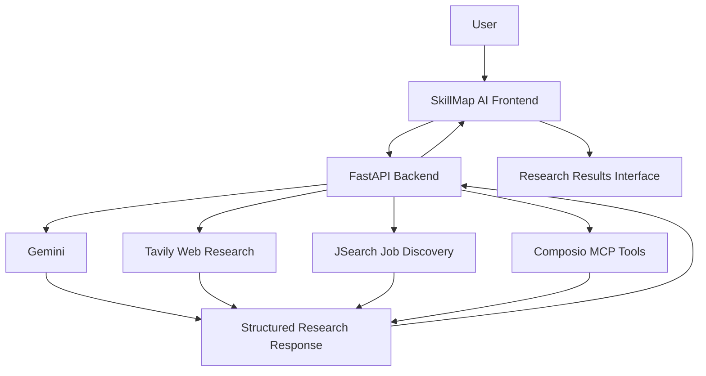

# skillmapagentwithmcp
# SkillMap AI — Career & Industry Intelligence Platform

**Turn career questions into actionable industry intelligence.**

SkillMap AI is an AI-powered career and industry research platform that combines language-model reasoning, web research, job-market data, and tool orchestration to help users explore industry trends, identify relevant skills, and discover job opportunities.

Instead of searching across disconnected sources manually, users can submit a natural-language question and receive a structured research response through a unified interface.

---

## Overview

Understanding an industry requires more than reading job descriptions. Candidates need to understand what employers are looking for, which skills matter, where opportunities exist, and how to approach their next career move.

SkillMap AI brings these research tasks into one workflow by combining AI-powered synthesis with external information sources.

### Key capabilities

- **AI-powered industry research** — Generate structured responses to natural-language career and industry questions.
- **Skill intelligence** — Identify relevant skills from the returned research and organize them into a readable overview.
- **Job opportunity discovery** — Retrieve job listings through the JSearch API integration.
- **Web research** — Use Tavily to retrieve relevant web information for research and synthesis.
- **Tool orchestration** — Integrate Composio MCP tools into the research workflow.
- **Structured responses** — Return research findings, skills, job opportunities, sources, metadata, and warnings through a defined API contract.
- **Partial-result handling** — Preserve useful output when an individual research provider fails, where supported by the backend.
- **Interactive frontend** — Submit research questions and explore the resulting intelligence through a dedicated web interface.

## Product workflow

1. **Ask** — Submit a question about an industry, role, skill set, or job market.
2. **Research** — The backend coordinates the available AI and external research integrations.
3. **Analyze** — Gemini helps synthesize information into a structured response.
4. **Discover** — Explore relevant skills, job opportunities, and available sources.
5. **Act** — Use the findings and job links to guide further research and career planning.

## Architecture



The frontend communicates with the backend through HTTP API endpoints. External provider credentials are maintained on the backend rather than exposed to browser code.

The diagram represents the high-level integration architecture; the actual execution order and available results depend on the backend implementation and provider responses.

## Technology stack

| Layer | Technologies |
|---|---|
| Frontend | Next.js, React, TypeScript |
| Styling and interaction | Tailwind CSS, Framer Motion |
| Backend | Python, FastAPI |
| AI reasoning | Google Gemini (`gemini-2.5-flash`) |
| Job search | RapidAPI JSearch |
| Web research | Tavily |
| Tool integration | Composio MCP |
| API documentation | FastAPI / OpenAPI |
| Frontend hosting | Vercel |
| Backend hosting | Render |
| Version control | Git and GitHub |

## Project structure

```text
skillmapagentwithmcp/
├── backend/
│   ├── app/
│   │   ├── main.py
│   │   ├── config.py
│   │   ├── schemas.py
│   │   ├── api/
│   │   │   └── routes.py
│   │   ├── agent/
│   │   │   └── skill_agent.py
│   │   ├── services/
│   │   │   └── skillmap_service.py
│   │   └── tools/
│   │       └── job_search.py
│   ├── tests/
│   ├── .env.example
│   └── requirements.txt
├── frontend/
├── mcp.ipynb
└── README.md
```

The structure above reflects the current project layout at a high level. Consult the repository for the complete list of files.

## Getting started

### Prerequisites

Install the following before running the project locally:

- Python 3.12 or another version supported by the backend dependencies.
- Node.js and npm compatible with the frontend project.
- Git.
- API credentials for the integrations you intend to use.

### 1. Clone the repository

```bash
git clone https://github.com/charansai12322/skillmapagentwithmcp.git
cd skillmapagentwithmcp
```

### 2. Set up the backend

```bash
cd backend

python -m venv .venv
```

Activate the virtual environment.

**Windows PowerShell**

```powershell
.\.venv\Scripts\Activate.ps1
```

**macOS / Linux**

```bash
source .venv/bin/activate
```

Install the dependencies:

```bash
pip install -r requirements.txt
```

### 3. Configure environment variables

Create a `.env` file inside `backend/`, using `.env.example` as the template.

```dotenv
GEMINI_API_KEY=your_gemini_api_key
RAPIDAPI_KEY=your_rapidapi_key
TAVILY_API_KEY=your_tavily_api_key
COMPOSIO_API_KEY=your_composio_api_key
```

Add any other variables required by the current backend configuration, including frontend-origin settings where applicable.

**Security:** Never commit `.env` files or place provider API keys in frontend source code. Keep `.env` excluded from Git and configure production secrets through the hosting provider's environment settings.

### 4. Start the backend

From the `backend/` directory:

```bash
uvicorn app.main:app --host 127.0.0.1 --port 8000 --reload
```

The local backend will be available at:

- API base URL: `http://127.0.0.1:8000`
- Health endpoint: `http://127.0.0.1:8000/api/health`
- Interactive API documentation: `http://127.0.0.1:8000/docs`

### 5. Set up the frontend

Open a second terminal:

```bash
cd frontend
npm install
```

Create the frontend environment file supported by the application and configure the API base URL.

For example:

```dotenv
NEXT_PUBLIC_API_BASE_URL=http://127.0.0.1:8000
```

Use the actual environment variable referenced by the frontend implementation if its name differs.

Start the development server:

```bash
npm run dev
```

Open the local URL printed by the development server, commonly `http://localhost:3000`.

## API reference

### Health check

**Endpoint:** `GET /api/health`

Checks the backend health endpoint and reports the configured service status according to the implementation.

Example:

```bash
curl http://127.0.0.1:8000/api/health
```

### Career intelligence query

**Endpoint:** `POST /api/query`

Accepts a research request and returns the structured result defined by the backend's response schema.

Example request:

```json
{
  "query": "Analyze entry-level AI engineering opportunities in India",
  "location": "India",
  "country": "in",
  "experience_level": "entry",
  "remote_only": false
}
```

The request fields must match the current backend schema.

Example using curl:

```bash
curl -X POST "http://127.0.0.1:8000/api/query" \
  -H "Content-Type: application/json" \
  -d '{
    "query": "Analyze entry-level AI engineering opportunities in India",
    "location": "India",
    "country": "in",
    "experience_level": "entry",
    "remote_only": false
  }'
```

Inspect `/docs` for the authoritative request and response definitions.

Depending on the providers' responses, the API may return an industry overview, key skills, job opportunities, sources, metadata, and warnings.

## Testing

The backend includes automated tests covering its API, schemas, job-search integration, and research-related functionality.

Run the backend test suite from the `backend/` directory:

```bash
python -m pytest -v tests
```

The integration should also be tested against the real external services separately from mocked unit tests.

Before deploying changes, verify:

- Backend tests pass.
- The health endpoint responds successfully.
- A real query returns a valid structured response.
- External job links and available sources are preserved.
- Provider failures are handled without exposing credentials.
- The frontend communicates with the correct backend URL.

## Deployment

### Frontend — Vercel

1. Import the GitHub repository into Vercel.
2. Set the Root Directory to `frontend`.
3. Confirm that Vercel detects the correct frontend framework and build settings.
4. Configure the production API base URL to point to the deployed Render backend.
5. Deploy and test a real research query.

If the frontend package configuration is located somewhere other than `frontend/`, configure the Root Directory accordingly.

### Backend — Render

1. Create a Render Web Service connected to the repository.
2. Set the Root Directory to `backend`.
3. Set the build command to `pip install -r requirements.txt`.
4. Set the start command to:

   ```bash
   uvicorn app.main:app --host 0.0.0.0 --port $PORT
   ```

5. Add the required API keys and configuration through Render's environment settings.
6. Configure the health check path as `/api/health`.
7. Ensure the backend permits requests from the deployed frontend origin.
8. Test the live API after deployment.

## Security and reliability

- API credentials belong on the backend.
- Environment files must not be committed to source control.
- External API failures should be handled explicitly.
- Partial results should be distinguished from complete results.
- Job information should come from actual provider responses.
- Sources and application URLs should be preserved when available.
- The system should not fabricate missing job records, salary figures, or citations.

## Current project status

The project has undergone local backend and frontend testing. The backend verification report recorded **52 passing automated tests**, successful live JSearch smoke tests, and a successful local end-to-end query.

These results describe the reported local verification; they do not by themselves establish that the latest production deployment is functioning correctly. Production readiness should be confirmed against the deployed frontend and backend.

## Future improvements

Potential directions for further development include:

- Persistent saved searches and research history.
- More detailed skill-to-role mapping.
- Evidence-linked research findings.
- User-specific career roadmaps.
- Improved filtering and comparison of job opportunities.
- Better visibility into source freshness and research limitations.
- More granular research progress reporting.

These are potential extensions, not claims about currently implemented features.

## Contributing

1. Fork the repository.
2. Create a feature branch.
3. Make a focused change.
4. Run the relevant tests.
5. Open a pull request with a clear description of the change.

## License

No license is specified here. Add a `LICENSE` file before describing the project as open source or granting reuse permissions.

---

**SkillMap AI** — Research the industry. Understand the skills. Explore the opportunities.
